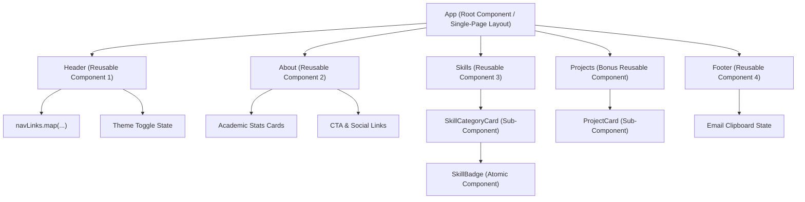

# Experiment: Introduction to React and Component Architecture

## 🎯 Aim / Objective
To set up a React development environment and build a static UI using reusable components for a student portfolio page.

The application incorporates **4 independently structured reusable components** composed into a single-page layout:
1. `Header` — Brand logo, navigation menu, status pill, theme switcher
2. `About` — Academic status (5th Sem IT B.Tech), bio, CGPA stats, contact buttons
3. `Skills` — Categorized technical coursework with sub-component composition (`SkillCategoryCard`, `SkillBadge`)
4. `Footer` — Interactive email clipboard copy, copyright, and student credentials
5. *(Bonus)* `Projects` — Reusable project cards with live links and tech tags

---

## 🏗️ Component Architecture Tree



---

## 📁 Project Directory Structure

```text
react-portfolio/
├── preview.html              <-- ⚡ INSTANT RUN: Double click to run in browser without Node!
├── index.html                <-- Standard Vite HTML entry
├── vite.config.js            <-- Vite React configuration
├── package.json              <-- Dependencies & scripts
├── src/
│   ├── main.jsx              <-- React 18 DOM mount (createRoot)
│   ├── App.jsx               <-- Single-page layout composing all 4+ components
│   ├── App.css               <-- CSS design system (Dark & Light mode)
│   ├── data/
│   │   └── portfolioData.js  <-- Data store passed to components via props
│   └── components/
│       ├── Header.jsx        <-- Component 1: Header
│       ├── About.jsx         <-- Component 2: About
│       ├── Skills.jsx        <-- Component 3: Skills (with SkillCategoryCard & SkillBadge)
│       ├── Projects.jsx      <-- Bonus Component: Projects (with ProjectCard)
│       └── Footer.jsx        <-- Component 4: Footer (with Copy Email state)
└── README.md
```

---

## 🚀 How to Run

### Method 1: Instant Browser Preview (Zero Installation Required)
Double-click `preview.html` in your file explorer. It uses React 18 and Babel directly in the browser with no build steps or Node.js required. Perfect for immediate lab demonstrations!

### Method 2: Standard Vite Development Server
When Node.js is installed on your computer:

1. **Install Node.js (if not already installed)**:
   Open PowerShell and run:
   ```powershell
   winget install OpenJS.NodeJS.LTS
   ```
   *(Restart your terminal after installation)*

2. **Install dependencies & start dev server**:
   ```bash
   cd react-portfolio
   npm install
   npm run dev
   ```
3. Open `http://localhost:5173` in your browser.

---

## 💡 Key React Concepts Demonstrated

1. **Component Reusability**: Components like `SkillCategoryCard`, `SkillBadge`, and `ProjectCard` are defined once and instantiated multiple times with different data.
2. **Unidirectional Data Flow (Props)**: All student information resides in `portfolioData.js` and flows downwards from `App.jsx` into child components via immutable props.
3. **State Management (`useState`)**:
   - `theme` state (`light` / `dark`) in `App.jsx` dynamically toggles CSS custom properties.
   - `copied` boolean state in `Footer.jsx` provides interactive clipboard feedback.
4. **Side Effects (`useEffect`)**: Synchronizes the current active theme with the HTML root element and browser `localStorage`.

---

## 🎓 Common Lab Viva Questions & Answers

* **Q: What is a React Component?**
  * *A:* A self-contained, reusable block of code that returns JSX describing a portion of the user interface.
* **Q: How do components communicate in React?**
  * *A:* Through `props` (properties) passed from parent components to child components in a unidirectional (top-down) manner.
* **Q: What is the benefit of component-based architecture?**
  * *A:* It promotes separation of concerns, code reusability, modular testing, and makes large applications easier to maintain.
