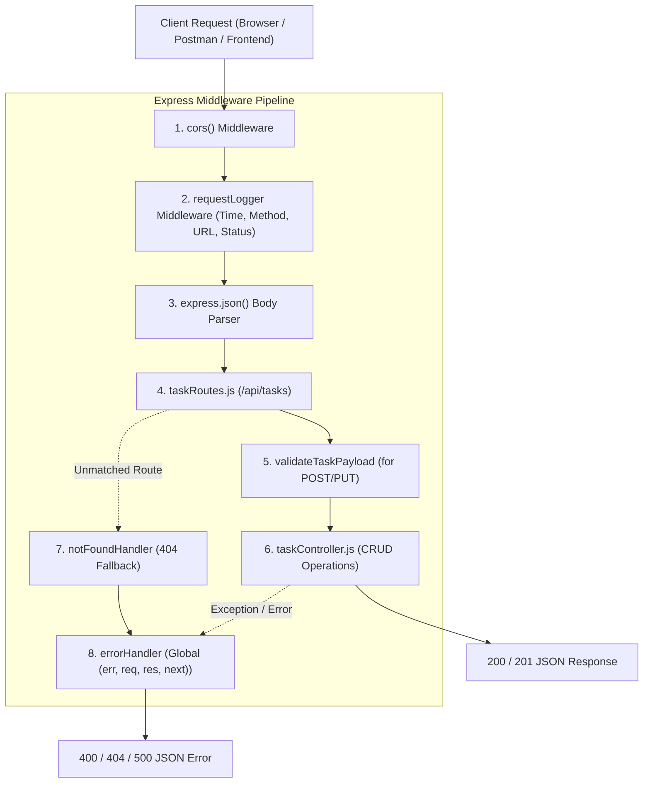

# Practical 4: Building a RESTful API with Node.js and Express

## 🎯 Aim / Objective
To design and implement a RESTful backend server with complete CRUD endpoints for a Task Management system using the Express middleware pipeline, including custom request logging and global error handling middleware.

---

## 🏗️ Express Middleware Pipeline Architecture



---

## 📡 REST API Endpoints Specification

| HTTP Method | Route | Description | Middleware Applied | Success Code |
| :--- | :--- | :--- | :--- | :--- |
| `GET` | `/api/tasks` | Read all tasks (supports `?status=&priority=&search=`) | `requestLogger` | `200 OK` |
| `GET` | `/api/tasks/:id` | Read single task by ID | `requestLogger`, `notFoundHandler` | `200 OK` / `404` |
| `POST` | `/api/tasks` | Create a new task | `requestLogger`, `validateTaskPayload` | `201 Created` |
| `PUT` | `/api/tasks/:id` | Update an existing task | `requestLogger`, `validateTaskPayload` | `200 OK` / `404` |
| `DELETE` | `/api/tasks/:id` | Delete a task by ID | `requestLogger` | `200 OK` / `404` |

---

## 🚀 How to Run the Server

```bash
cd C:\Users\rishi\.gemini\antigravity\scratch\task-manager-api
npm install
npm start
```

### Running Automated CRUD Tests
In PowerShell:
```powershell
.\test-api.ps1
```

---

## 🎓 Common Lab Viva Questions & Answers

* **Q: What is middleware in Express?**
  * *A:* Functions that have access to the request (`req`), response (`res`), and the `next` function in the application's request-response cycle. They can execute code, modify `req`/`res`, end the cycle, or invoke `next()`.
* **Q: How does Express differentiate standard middleware from error-handling middleware?**
  * *A:* Error-handling middleware **must take exactly 4 parameters**: `(err, req, res, next)`.
* **Q: Why is `express.json()` required?**
  * *A:* It parses incoming HTTP request bodies formatted as JSON and populates `req.body`. Without it, `req.body` is `undefined`.
